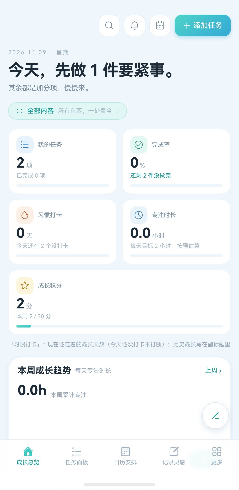
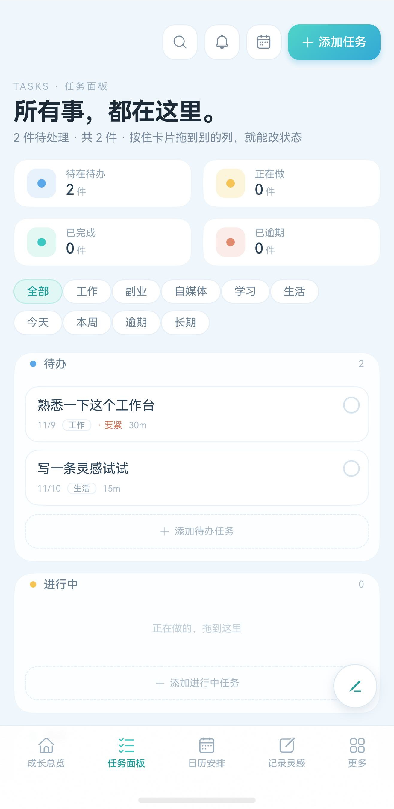
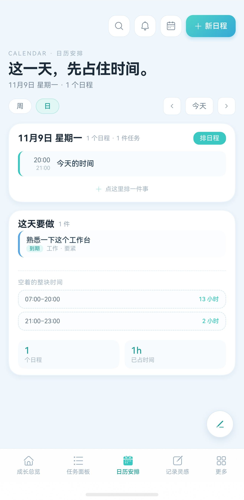
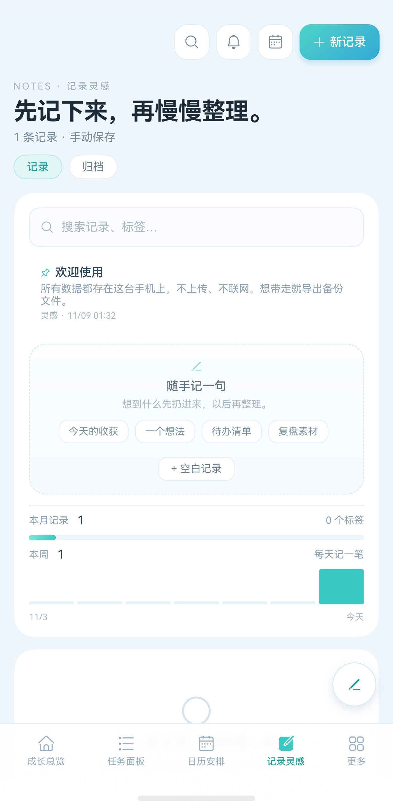
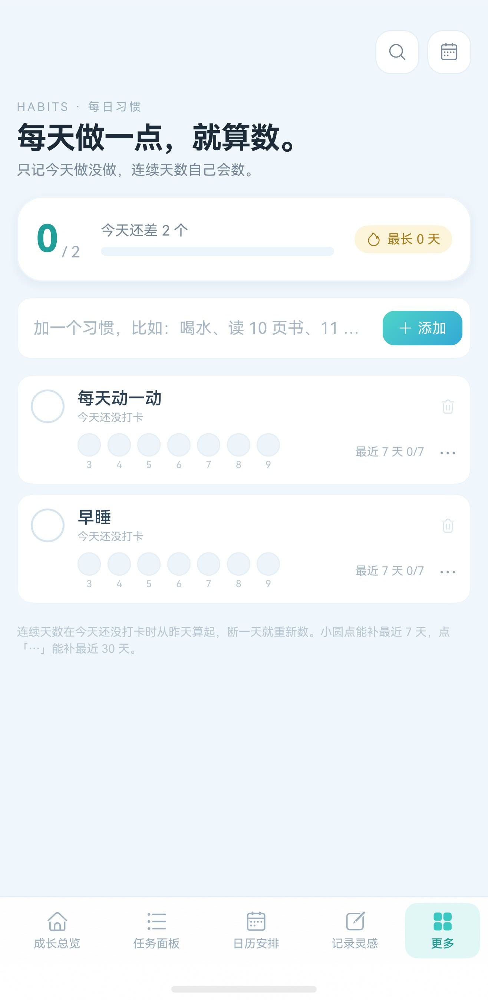
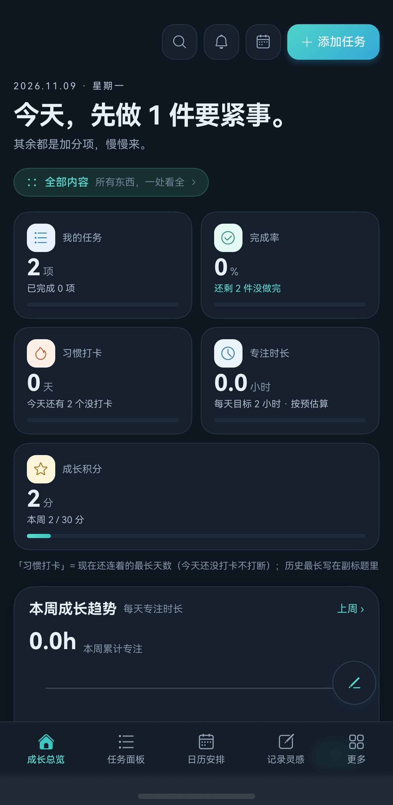

# 小记 · Xiaoji

> **一个纯离线、不联网、不申请任何系统权限的鸿蒙个人工作台。**
> 任务、日程、灵感、习惯、项目、复盘、数据洞察 —— 全部只存在你自己这台手机上。

[]()
[]()
[]()

---

## 目录

- [这是什么](#这是什么)
- [界面](#界面)
- [核心特性](#核心特性)
- [技术栈](#技术栈)
- [架构](#架构)
- [目录结构](#目录结构)
- [快速开始](#快速开始)
- [签名配置](#签名配置)
- [设计系统](#设计系统)
- [文档](#文档)
- [已知限制](#已知限制)
- [一起做](#一起做)

---

## 这是什么

「小记」是一个**给普通人用的个人工作台**，把网页版工作台搬到了鸿蒙手机上，但做了三件网页版做不到的事：

1. **彻底离线** —— 数据全部在本机 SQLite（`relationalStore`），**不联网、不注册、没有账号**。
   App 在系统层面就没有网络权限（`module.json5` 里 **零权限声明**，`bm dump` 出来 `reqPermissions: []`）。
2. **不上传** —— 没有埋点、没有三方 SDK、没有统计。备份靠你自己导出 JSON 文件。
3. **平板/折叠屏是认真的** —— 不是把手机界面拉宽：宽屏走「左侧导航栏 + 右侧内容区」，
   按 600vp / 900vp 两档断点重排，卡片按 3 栏瀑布流分布（和网页端一致）。

一句话：**你的数据只在你的手机里，谁也拿不走。**

---

## 界面

| 成长总览 | 任务面板 | 日历安排 |
|---|---|---|
|  |  |  |

| 记录灵感 | 每日习惯 | 深色模式 |
|---|---|---|
|  |  |  |

---

## 核心特性

### 📋 任务面板
- 三列看板：**待办 / 进行中 / 已完成**，每列实时计数，支持「工作 / 副业 / 自媒体 / 学习 / 生活」领域筛选。
- **长按卡片拖到别的列就能改状态** —— 拖动时浮卡跟手，落下即生效，不用进编辑页。
- 逾期任务自动标红「逾期 N 天」；「长期任务」（无截止日）单独归类，不污染今天的清单。

### 📅 日历安排
- 月视图 + 周视图，任务与日程合并显示，重复日程自动展开。
- 每个任务的截止时间 / 开始时间独立可配，结束时间自动算。
- 本周安排卡可点日期直达当天。

### 💡 记录灵感
- **整屏编辑器**：上面是大输入框（标题），下面「补充（可选）」。
- 保存按钮在**右上角**（单手操作），保存后自动关掉编辑器并即时刷新列表。
- 支持 Markdown（标题、列表、引用）、置顶、归档、标签。
- 删除走自绘确认弹窗，不是系统默认那个丑的 AlertDialog。

### 🎯 每日习惯
- 打卡圆点行 + 「最近 7 天 N/7」进度；30 天补卡网格（点「⋯」补更早的打卡）。
- 连续天数、历史最长天数都算给你看。

### 📈 数据洞察
- 26 周热力图、专注时长趋势、模块投入占比、每日完成数 —— 全部本地统计。
- 图表用 Canvas 手绘（坐标单位是 vp 不是 px，字体必须是 `字号+字体族` 的完整简写）。

### 🔒 隐私
- **首启隐私门**：不同意就不进。
- 设置里能看完整的《用户协议》和《隐私政策》。
- 一键导出备份 / 一键恢复（恢复前会校验 JSON，失败时**原数据一条不动**）。

### 🌗 宽屏
- 平板与折叠屏：左侧 224vp/168vp 导航栏 + 右侧内容区，卡片 3 栏瀑布流。
- 手机：底部 5 个 Tab。

### ✨ 交互细节
- 滑到顶部/底部会**回弹**并弹出「已经到顶了 / 已经到底了」提示。
- 弹层窄屏贴底、宽屏居中成卡片，两套形态自动切换。
- 所有按钮都有 ≥48vp 的点击热区，所有图标 ≥12vp。

---

## 技术栈

| 项 | 选择 |
|---|---|
| 语言 | ArkTS（严格模式） |
| UI | ArkUI 声明式（`@Component` / `@Builder` / `@State` / `@StorageLink`） |
| 数据 | `@ohos.data.relationalStore`（SQLite，本地 9 张表 6 个索引） |
| 状态 | 自写 `Store` 单例（乐观更新 + 失败回滚 + 订阅通知） |
| 适配 | `Responsive.ets` 断点（Compact / Medium / Expanded） |
| 主题 | `Theme.ets` token 化，浅色 / 深色双套，运行时切换并持久化 |
| 权限 | **零** —— 不申请任何系统权限 |
| 网络 | **无** —— 代码里没有网络层 |
| 最低版本 | HarmonyOS API 24（`compatibleSdkVersion: "6.1.1(24)"`） |
| 目标版本 | API 26 |

---

## 架构

```
View（.ets 页面/组件）
  └─ Store（单一数据源，乐观更新 + 回滚）
       └─ Repo（把 HTTP 接口一一对应成同名的本地方法）
            └─ Db（relationalStore，事务、索引、种子数据）
```

**关键设计**：

- **Repo 的方法名与返回结构，和当年网页版的 HTTP 接口一一对应** ⇒ 视图层几乎一行没改地完成了从「联网」到「离线」的改造。
- **只读本地库也走一层 Store**，是为了让 UI 永远只认一个数据源，不会出现「页面自己查库、Store 又查一遍」的双写问题。
- 派生数字（完成率、连续天数、逾期数…）**全部预计算进 `@State`**，UI 里只直接读 state ——
  ArkUI V1 只有「属性表达式里直接读过 state 变量」的节点才会重画，方法调用里读 state **不算依赖**（这是本项目最大的一个坑）。

---

## 目录结构

```
workbench/
├── AppScope/                     应用级资源（图标两层、app.json5）
├── entry/src/main/
│   ├── ets/
│   │   ├── entryability/         EntryAbility（深链、初始化、主题恢复）
│   │   ├── pages/Index.ets       唯一入口页：底部导航 / 侧栏 / 弹层宿主
│   │   ├── views/                12 个页面视图（首页、任务、日历、灵感…）
│   │   ├── components/           17 个复用组件（卡片、表单、确认弹窗、图表…）
│   │   ├── store/Store.ets       全局数据源
│   │   ├── db/                   Db / Repo / Boot / LocalAI
│   │   ├── api/Types.ets         数据类型定义
│   │   └── utils/                Theme / DateUtil / Toast / Responsive / EdgeHint
│   └── resources/                字符串、媒体、main_pages.json
├── docs/                         开发文档 + 项目全史（见下）
├── legacy-server-client/         v4.0 之前的联网客户端（已归档，不进编译图）
├── tools/                        构建辅助脚本
├── sign.sh                       自签兜底脚本
└── build-profile.json5.example   构建配置模板（真文件不入库，见「签名配置」）
```

---

## 快速开始

### 环境

- DevEco Studio **26.0.0**，SDK API **26**
- 纯 OpenHarmony 也能跑（不碰 `hms/` 目录）

### 命令行构建

```bash
cd workbench

# 三条环境变量必须设，否则分别报 00303217 / 00308018
export NODE_HOME="/Applications/DevEco-Studio.app/Contents/tools/node"
export JAVA_HOME="/Applications/DevEco-Studio.app/Contents/jbr/Contents/Home"   # DevEco 自带 JBR，不用装 Java
export DEVECO_SDK_HOME="/Applications/DevEco-Studio.app/Contents/sdk"

# 改过 .ets 之后务必先删这个，否则孤儿文件不进编译图
rm -f entry/build/default/intermediates/loader_out/default/ets/modules.abc

node "/Applications/DevEco-Studio.app/Contents/tools/hvigor/bin/hvigorw.js" \
  assembleHap --mode module -p product=default -p buildMode=debug --no-daemon
```

产物：`entry/build/default/outputs/default/entry-default-signed.hap`

> ⚠️ 编译前那行 `rm -f` 别省。hvigor 的 `CompileArkTS` 只沿 `main_pages.json` 注册的页面追 import，
> 删掉过期的 `.ets` 不进编译图时，**`BUILD SUCCESSFUL` 是具欺骗性的**。

### 出商店包（.app）

```bash
node ".../hvigorw.js" assembleApp --mode project -p product=default -p buildMode=release --no-daemon
# 产物：build/outputs/default/workbench-default-signed.app
```

> 商店只收 `.app`，不收 `.hap`。

---

## 签名配置

**本仓库不含任何签名私钥。** 被 `.gitignore` 排除的有：

| 路径 | 为什么排除 |
|---|---|
| `sign/` | 发布私钥 `.p12`、AGC profile、证书链、hvigor 解密材料，以及写着明文口令的说明文档 |
| `tools/signing/` | 本机绝对路径 + 加密口令 |
| `build-profile.json5` | 同上（含三套 signingConfig） |
| `*.p12` `*.p7b` `*.csr` `*.cer` `*.keystore` | 兜底 |

> 丢了发布私钥，已上架的 App 就再也发不了更新（只能重做证书、重新上架，等于从头再来一次审核）。
> **请自己把 `sign/` 备份到网盘或密码管理器。**

### 两种配法

**A. DevEco 自动签名（推荐）**

`File → Project Structure → Signing Configs` → 勾「自动生成签名」→ 选设备 → 保存。
DevEco 会把配置写进 `build-profile.json5`（该文件已被 gitignore）。

**B. 手动填**

```bash
cp build-profile.json5.example build-profile.json5
```

然后把 `signingConfigs` 填上：

```json5
{
  "name": "release",
  "type": "HarmonyOS",
  "material": {
    "storeFile": "sign/xxx.p12",
    "storePassword": "<hvigor 加密后的 hex>",
    "keyAlias": "xxx",
    "keyPassword": "<hvigor 加密后的 hex>",
    "profile": "sign/xxx.p7b",
    "certpath": "sign/xxx.cer",
    "signAlg": "SHA256withECDSA"
  }
}
```

> 口令**必须写加密后的 hex，不能写明文**，否则报
> `00303116 ... length of the storePassword or keyPassword field ... is less than 32`。

---

## 设计系统

全部颜色收在 `utils/Theme.ets` 的 token 表里，浅色 / 深色两套，运行时切换。

| token | 浅色 | 深色 | 用途 |
|---|---|---|---|
| `bg` | `#EFF6FC` | `#0E1620` | 页面底 |
| `card` | `#FFFFFF` | `#16202C` | 卡片 |
| `text` | `#1D2A38` | `#E8EFF7` | 正文 |
| `textSub` | `#596879` | `#93A6B8` | 次级文字 |
| `textHint` | `#52697E` | `#8B9AAA` | 弱提示 |
| `brand` | `#12706B` | `#3AC8C2` | 主色（填充） |
| `brandDeep` | `#0F6B66` | `#57D8D0` | 主色（深） |
| `work` / `side` / `media` | `#1A6499` / `#6650C8` / `#A54A1E` | — | 领域色 |
| `study` / `life` / `event` | `#0F6E58` / `#8A5A0F` / `#276AA4` | — | 领域色 |

### 对比度是被硬指标卡过的

华为 UX 规范 2.1.4.1 要求：图标或标题文字与背景 **> 3:1**，正文文字与背景 **> 4.5:1**。
本工程所有文字色**按 24 种真实底色取最差值 ≥ 4.6:1** 反算过，脚本全量扫描 325 个文字色调用点，**不达标 0 处**。

> 踩过的坑：白色文字压在品牌色上对比度只有 2.05:1，会被打回。
> 解法是**把填充色压深**（`#3AC8C2` → `#12706B`），而不是把字改黑 —— 亮底深字很难看。

---

## 文档

| 文档 | 内容 |
|---|---|
| [`docs/开发文档.md`](docs/开发文档.md) | **技术规格**：架构、数据模型、每个页面的实现要点、设计系统、**50 条踩坑**、上架清单 |
| [`docs/开发文档说明-项目全史.md`](docs/开发文档说明-项目全史.md) | **项目全史**：从第一个需求到上架的完整脉络、**63 条需求台账**（你的原话 → 落地 → 状态）、22 个版本里程碑、踩坑总账 |

两份文档加起来 33 万字，是这个项目最完整的两份记录。

---

## 已知限制

- **没有桌面卡片**（form / 卡片服务）—— 属于可选增强，排在后面。
- **没有系统通知提醒** —— v4.20 起彻底去掉了通知权限。提醒改成 App 顶部的「铃铛清单」：
  列出「已经逾期」「今天到期」「12 小时内要做」的事，**只在 App 打开时自己出现**。
  这是零权限的代价，也是刻意的取舍。
- **没有横向滚动容器** —— 「滑到最左/最右」的提示文案已经备好，等哪天真加了横向 `Scroll` 就能用上。
- 桌面端 / 智慧屏 / 穿戴的字号规范未适配（当前只按手机 / 折叠屏 / 平板做）。
- 上架所需的**软著、ICP 备案、实名认证**等外部资质不包含在本仓库里。

---

## 一起做

欢迎提 issue、提 PR，特别是：

- **桌面卡片**（service widget / form）—— 最有价值的一块空白
- **备份格式的向后兼容** —— 老版本导出的 JSON 能不能被新版本读懂
- **更宽的设备适配**（智慧屏 / 穿戴）
- 翻译（目前只有中文）

---

## 许可

MIT License。

本项目与华为、OpenHarmony 无隶属关系。「HarmonyOS」「ArkUI」「ArkTS」等名称归各自权利人所有。
